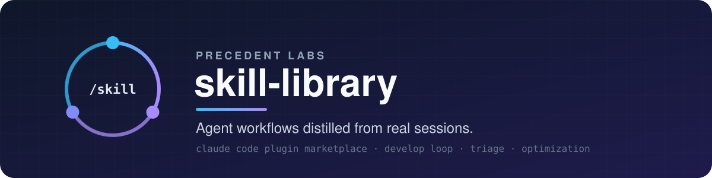
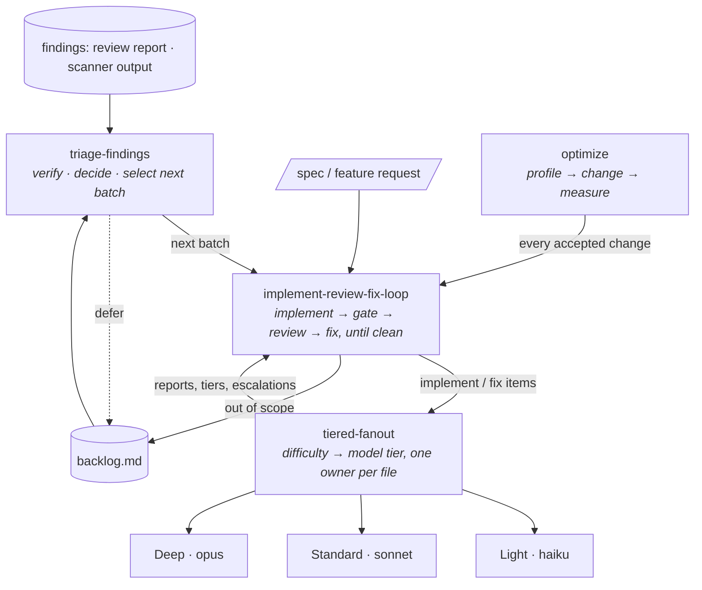

<p align="center">
  
</p>

<p align="center">
  <a href="https://docs.claude.com/en/docs/claude-code/plugin-marketplaces"></a>
  
  
  <a href="LICENSE"></a>
</p>

<p align="center">
  
  
  
</p>

<p align="center">
  <b>Reusable agent workflows, distilled from real sessions.</b><br>
  Triage that picks what to fix next, a develop loop that every change goes through, model-tiered<br>
  subagent fanout, and an optimization loop where every change is kept or reverted by a measurement.
</p>

<p align="center">
  <a href="#-quick-start">Quick start</a> ·
  <a href="#-the-skills">Skills</a> ·
  <a href="#-how-they-fit-together">How they fit together</a> ·
  <a href="#-principles">Principles</a> ·
  <a href="#-contributing-a-skill">Contributing</a>
</p>

---

## ⚡ Quick start

Add the marketplace and install the plugins inside Claude Code:

```text
/plugin marketplace add precedentlabs/skill-library
/plugin install develop-loop@precedentlabs-skills
/plugin install optimization@precedentlabs-skills
```

A local checkout works too:

```text
/plugin marketplace add ./skill-library
```

Upgrading from `review-loop`: the plugin was renamed to `develop-loop` and
`review-fix-fanout` became `tiered-fanout`. Remove the old plugin as well, or both sets of
skills stay loaded:

```text
/plugin uninstall review-loop@precedentlabs-skills
```

Skills trigger on their own when a request matches their description. The two that take an
argument can also be invoked directly:

```text
/optimization:optimize cut cold-start time
/develop-loop:triage-findings backlog.md
```

### oh-my-pi

[oh-my-pi](https://github.com/can1357/oh-my-pi) installs the same marketplace:

```text
/marketplace add precedentlabs/skill-library
/marketplace install develop-loop@precedentlabs-skills
/marketplace install optimization@precedentlabs-skills
```

Upgrading from `review-loop`: also run `/marketplace uninstall review-loop@precedentlabs-skills`.

Direct invocation needs `skills.enableSkillCommands: true`:
`/skill:optimize cut cold-start time`, `/skill:triage-findings backlog.md`.

oh-my-pi ignores the `model` of Claude-format plugin agents, so without routing every
`dl-*` agent runs on the parent's model and the tiers are lost. `tiered-fanout` checks the
routing before its first spawn and, when it is missing, asks once: add it, or run the
session untiered on the parent's model. Route the `dl-*` agents through model roles in
`~/.omp/agent/config.yml` (or a project's `.omp/config.yml`); point a role at another
provider's model to change a tier everywhere:

```yaml
modelRoles:
  dl_light: anthropic/claude-haiku-5-5:high
  dl_standard: anthropic/claude-sonnet-5-5:high
  dl_deep: anthropic/claude-opus-5-5:medium
  dl_review: anthropic/claude-opus-5-5:high
task:
  agentModelOverrides:
    dl-implementer-light: "@dl_light"
    dl-implementer-standard: "@dl_standard"
    dl-implementer-deep: "@dl_deep"
    dl-runner: "@dl_light"
    dl-reviewer: "@dl_review"
```

Tool limits (`disallowedTools`) are Claude Code only: in oh-my-pi, `dl-reviewer` and
`dl-runner` stay read-only by their prompts.

## 🧰 The skills

| Plugin | Skill | In one line |
|---|---|---|
| **develop-loop** | [`triage-findings`](plugins/develop-loop/skills/triage-findings/SKILL.md) | Findings in, decisions out: fix now · quick sweep · defer · reject · needs decision; selects the next batch |
| **develop-loop** | [`implement-review-fix-loop`](plugins/develop-loop/skills/implement-review-fix-loop/SKILL.md) | All implementation work: implement in disjoint units, then review → fix until no critical, major or minor finding is left |
| **develop-loop** | [`tiered-fanout`](plugins/develop-loop/skills/tiered-fanout/SKILL.md) | The loop's implement and fix work on parallel subagents, each on the model tier its difficulty needs, one owner per file |
| **optimization** | [`optimize`](plugins/optimization/skills/optimize/SKILL.md) | Metric-driven loop: baseline, profile, one change per iteration, accept or reject by measurement |

<details>
<summary><b>⚖️ <code>triage-findings</code></b> — decide what is worth fixing, pick the next batch</summary>

<br>

For a pile of findings — a review report, a backlog file, scanner or scout output. Produces
one table the user can approve in one read; it never changes code.

- **Verify before judging** — every finding is checked against the current tree; scanner and
  small-model findings are leads, not facts.
- **Project context overrides defaults** — repo rules and recorded decisions are read first.
- **Gates (first match decides)** — invalid → reject; contradicts a decision → needs decision;
  security / data loss / correctness → fix now; regression → fix now; unmet requirement or
  stale contract doc → fix now.
- **Value versus cost** for everything left, plus rules for performance, duplication, taste,
  tests and fixes that are worse than the problem.
- **Nothing is rejected silently** — every reject carries a reason a reviewer could not
  re-raise unchanged; deferrals carry a revisit trigger.
- **Next batch** — ordered by gate and severity, grouped by owning file, capped (default 5
  groups), handed to `implement-review-fix-loop`; the rest stays queued in the table.

</details>

<details>
<summary><b>🔁 <code>implement-review-fix-loop</code></b> — implement, then loop review → fix until clean</summary>

<br>

For **all implementation work**: features, fixes, doc and test changes, batches from
`triage-findings`, accepted `optimize` changes; a small change runs the loop at its
smallest, never skips review. The orchestrator decides, gates and commits; subagents
implement, review and fix. Nothing is "done" on a subagent's word: the loop ends only on a
reviewer verdict (or a short cosmetic tail) **plus** a green gate the orchestrator judged
itself.

- **Contract first** — open decisions are written down before any code; work is split into
  units with disjoint file sets, ordered by risk.
- **Loop size** — trivial, single unit or multi-unit: the size sets which steps apply
  (decision record, worktree, reviewers, live smoke, minor sweep); gate and review are
  never skipped.
- **Explicit severity scale** — critical / major / minor / nit, restated in every reviewer prompt.
- **Convergence rule** — from round 2 on, only regressions, unmet requirements or defects on
  changed lines block; everything else goes to a backlog instead of looping forever.
- **Per-round protocol** — implement → gate + spot-read → `git add -N` (so new files
  show in the diff) → diff-scoped review (`TIER: keep | up`, `VERDICT: PASS | FIX`) →
  triage → fix → gate → re-review; implement and fix run through `tiered-fanout`; fixes go
  to subagents, and the orchestrator edits only in the few cases the skill lists, such as
  the takeover round below.
- **Reviewer upgrades the fixer** — reviewers always run on `opus-5-5:high`; a review that
  finds many problems in the developer's code sends the next fix round to a fresh agent
  one tier above the author, or at the findings' own tier if that is higher.
- **Round cap** — three automatic fix rounds with tier escalation, then a takeover round:
  the orchestrator fixes the unit itself and has it reviewed again.
- **Worktrees** per unit when units run in parallel; ready-to-use
  [prompt templates](plugins/develop-loop/skills/implement-review-fix-loop/prompts.md) for
  reviewer, re-review and minor sweep.

</details>

<details>
<summary><b>🔀 <code>tiered-fanout</code></b> — develop or fix with model-tiered subagents</summary>

<br>

For the develop loop's implement and fix work — feature units, approved fixes, sweeps — on
parallel subagents without file collisions, wasted model spend, silent guessing, or a gate
that fails at the very end. On its own it only runs tests, the gate or deployments.

| Tier | Agent | Model:effort | Work |
|---|---|---|---|
| Light | `dl-implementer-light`, `dl-runner` | `haiku-5-5:high` | docs, simple tests, mechanical edits, running tests, deployments |
| Standard | `dl-implementer-standard` | `sonnet-5-5:high` | small to medium coding work, no complicated algorithms |
| Deep | `dl-implementer-deep` | `opus-5-5:medium` | multi-module work, concurrency, complex algorithms, optimisations, large reasoning-heavy tasks |
| Review | `dl-reviewer` | `opus-5-5:high` | every review in the loop, read-only |

Each implementer's system prompt carries the rules every task needs (owned files only, no
gate, no commit, ask the parent, struggle handoff, report format); `dl-reviewer` and
`dl-runner` carry their read-only rules, the ask rule and their report format. Task
prompts carry only the work.

- **Escalation ladder** — `haiku-5-5:high` → `sonnet-5-5:high` → `opus-5-5:medium`, one step
  at a time, always to a fresh agent. Triggers: the agent itself struggles and sends a
  *struggle handoff* (its work, the struggle, what it tried) so a stronger model continues
  from its working tree; two failed fixes at one tier (red gate, unresolved finding or
  regression); a reviewer's `TIER: up`; or the orchestrator's own call.
- **One owner per file** — shared docs belong to one docs task or the parent; code tasks
  report the wording they need instead of editing the doc.
- **Ask, don't guess** — every spawned agent asks the parent when unsure or blocked; the
  parent answers with a binding decision, an ownership change, an escalation, or a question
  to the user.
- **Self-contained tasks**, spawned **once, in one batch**; a report per item and per tier
  goes back to the loop.

</details>

<details>
<summary><b>📈 <code>optimize</code></b> — measured, one change at a time</summary>

<br>

For making something measurably better — speed, latency, memory, binary or index size,
build or test time, token or API cost — as a disciplined, possibly unattended loop.

- **Frame the goal** — objective metric, per-goal invariants, guardrail metrics, boundaries
  that need an operator decision, stop rules, autonomy.
- **Build the measuring stick** — baseline is a named commit in its own worktree;
  representative workloads; a measured noise floor.
- **Profile first**, then **one change per iteration**, each in a fresh worktree.
- **Accept only** when the metric moves outside the noise floor, in the predicted direction,
  on more than one workload — with every invariant and guardrail intact. Rejections are
  recorded like acceptances, so ideas are not retried.
- **Develop-loop review** — every accepted change goes through `implement-review-fix-loop`
  (from its review step) before merge; the invariants are re-checked after its fixes, and a
  fix on the measured path is re-measured. Needs the `develop-loop` plugin.
- **Stop rules** — candidates below ~10 % of their path, operator decisions needed, three
  rejections in a row, target met, or budget spent. The stop reason is always stated.

</details>

## 🧭 How they fit together



- Calls run one way: `triage-findings` → `implement-review-fix-loop` → `tiered-fanout`. The
  only path back up is `backlog.md`, which triage reads to select the next batch.
- Inside the loop, `tiered-fanout` does the implement and fix steps; its agents never
  commit, and the loop owns the gate and the re-review. Outside the loop it only runs
  tests, the gate or deployments; every code or doc change goes through the loop.
- `optimize` keeps the timing loop serial; every accepted change goes through
  `implement-review-fix-loop` review before it is merged.

## 🧱 Principles

These run through every skill:

| | |
|---|---|
| **Evidence over assertion** | A finding is a claim until verified; a speed-up is a confound until a clean A/B confirms it. |
| **The orchestrator owns the gate** | Subagents implement, review and fix; only the orchestrator judges the gate (a cheap runner may execute it) and commits. |
| **Every change goes through the develop loop** | No change of any size lands without `implement-review-fix-loop`'s gate and review; only runs that change no files, and discarded `optimize` experiments, bypass it. |
| **Ask, don't guess** | Spawned agents that are unsure or blocked ask the orchestrator instead of working around the problem. |
| **Cheapest adequate model** | Work is tiered by difficulty; a struggling agent, two failed fixes at one tier, a reviewer's `TIER: up` or the orchestrator's call moves the item one tier up instead of retrying it at the same one. Reviewers always run on the strongest model. |
| **One owner per file** | Parallel work is partitioned so no two agents ever edit the same file. |
| **Decisions are written down** | Open questions are settled before code; rejects, deferrals and accepted trade-offs carry their reasons. |
| **Loops must converge** | Explicit stop conditions, round caps and backlogs instead of endless polishing. |
| **Operators decide trade-offs** | Rule exceptions, new dependencies and durability or security trade-offs are surfaced, never taken unilaterally. |

Every skill ends with a *pitfalls seen* section: failure modes observed in real sessions
that the procedure now guards against.

## 🗂️ Layout

```text
.
├── .claude-plugin/
│   └── marketplace.json            # marketplace catalogue (name: precedentlabs-skills)
├── scripts/
│   └── lint.py                     # consistency lint: agent bodies, versions and descriptions, § references, model ids, BOMs
└── plugins/
    ├── develop-loop/
    │   ├── .claude-plugin/plugin.json
    │   ├── agents/                 # dl-implementer-light|standard|deep, dl-reviewer, dl-runner
    │   └── skills/
    │       ├── triage-findings/SKILL.md
    │       ├── implement-review-fix-loop/
    │       │   ├── SKILL.md
    │       │   └── prompts.md      # reviewer / re-review / minor-sweep templates
    │       └── tiered-fanout/SKILL.md  # tiers, agents, task templates, ask-the-parent rule
    └── optimization/
        ├── .claude-plugin/plugin.json
        └── skills/
            └── optimize/SKILL.md
```

## 🤝 Contributing a skill

1. Put it at `plugins/<plugin>/skills/<name>/SKILL.md` with `name` and `description`
   frontmatter (the description starts with "Use when…").
2. New plugin: add its `.claude-plugin/plugin.json` and an entry in
   [`.claude-plugin/marketplace.json`](.claude-plugin/marketplace.json).
3. Bump the plugin `version` in both files when a skill changes.
4. Update the skill table and the plugin/skill counts in this README.
5. Agents: the three `dl-implementer-*` files share one body and differ only in `name`,
   `description`, `model` and `effort`; change the body in all three. A model change also
   goes into the oh-my-pi `modelRoles` snippet above. Skill and agent bodies name tiers,
   not models: model ids live only in the agent frontmatter, the agent table in
   `tiered-fanout` §4 and this README.
6. Run `python scripts/lint.py` before committing. It checks that the implementer bodies
   are identical, plugin versions and descriptions match in both files, no Markdown file or
   manifest starts with a UTF-8 BOM, every `§N` reference resolves, model ids appear only
   where step 5 allows, and this README's agent table and routing snippet match the agent
   frontmatter.

## 📄 License

[MIT](LICENSE) © Precedent Labs

---

<p align="center">
  <sub>Built by <a href="https://github.com/precedentlabs">Precedent Labs</a> · procedures earned the hard way, so your agents don't have to.</sub>
</p>
