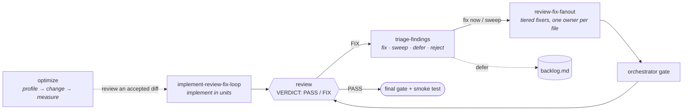

<p align="center">
  
</p>

<p align="center">
  <a href="https://docs.claude.com/en/docs/claude-code/plugin-marketplaces"></a>
  
  
</p>

<p align="center">
  
  
  
</p>

<p align="center">
  <b>Reusable agent workflows, distilled from real sessions.</b><br>
  Review loops that actually converge, triage that turns findings into decisions,<br>
  and an optimization loop where every change is kept or reverted by a measurement.
</p>

<p align="center">
  <a href="#-quick-start">Quick start</a> ·
  <a href="#-the-skills">Skills</a> ·
  <a href="#-how-they-fit-together">How they fit together</a> ·
  <a href="#-principles">Principles</a> ·
  <a href="#-contributing-a-skill">Contributing</a>
</p>

---

## ⚡ Quick start

Add the marketplace and install the plugins inside Claude Code:

```text
/plugin marketplace add precedentlabs/skill-library
/plugin install review-loop@precedentlabs-skills
/plugin install optimization@precedentlabs-skills
```

A local checkout works too:

```text
/plugin marketplace add ./skill-library
```

Skills trigger on their own when a request matches their description. The two that take an
argument can also be invoked directly:

```text
/optimization:optimize cut cold-start time
/review-loop:triage-findings backlog.md
```

## 🧰 The skills

| Plugin | Skill | In one line |
|---|---|---|
| **review-loop** | [`implement-review-fix-loop`](plugins/review-loop/skills/implement-review-fix-loop/SKILL.md) | Implement in disjoint units, then review → fix until no critical, major or minor finding is left |
| **review-loop** | [`triage-findings`](plugins/review-loop/skills/triage-findings/SKILL.md) | Findings in, decisions out: fix now · quick sweep · defer · reject · needs decision |
| **review-loop** | [`review-fix-fanout`](plugins/review-loop/skills/review-fix-fanout/SKILL.md) | Fan review fixes out to model-tiered subagents, one owner per file, one final gate |
| **optimization** | [`optimize`](plugins/optimization/skills/optimize/SKILL.md) | Metric-driven loop: baseline, profile, one change per iteration, accept or reject by measurement |

<details>
<summary><b>🔁 <code>implement-review-fix-loop</code></b> — implement, then loop review → fix until clean</summary>

<br>

For "implement this and repeat review until nothing blocks". The orchestrator decides, gates
and commits; subagents implement, review and fix. Nothing is "done" on a subagent's word:
the loop ends only on a reviewer verdict **plus** a green gate the orchestrator ran itself.

- **Contract first** — open decisions are written down before any code; work is split into
  units with disjoint file sets, ordered by risk.
- **Explicit severity scale** — critical / major / minor / nit, restated in every reviewer prompt.
- **Convergence rule** — from round 2 on, only regressions, unmet requirements or defects on
  changed lines block; everything else goes to a backlog instead of looping forever.
- **Per-round protocol** — implement → gate + spot-read → diff-scoped review
  (`VERDICT: PASS | FIX`) → triage → fix in the same session → gate → re-review.
- **Round cap** — three automatic fix rounds, then a human round.
- **Worktrees** per unit when units run in parallel; ready-to-use
  [prompt templates](plugins/review-loop/skills/implement-review-fix-loop/prompts.md) for
  implementer, reviewer, re-review and minor sweep.

</details>

<details>
<summary><b>⚖️ <code>triage-findings</code></b> — decide what is worth fixing</summary>

<br>

For a pile of findings — a review report, a backlog file, scanner or scout output. Produces
one table the user can approve in one read; it never changes code.

- **Verify before judging** — every finding is checked against the current tree; scanner and
  small-model findings are leads, not facts.
- **Project context overrides defaults** — repo rules and recorded decisions are read first.
- **Gates (first match decides)** — invalid → reject; contradicts a decision → needs decision;
  security / data loss / correctness → fix now; regression → fix now; unmet requirement or
  stale contract doc → fix now.
- **Value versus cost** for everything left, plus rules for performance, duplication, taste,
  tests and fixes that are worse than the problem.
- **Nothing is rejected silently** — every reject carries a reason a reviewer could not
  re-raise unchanged; deferrals carry a revisit trigger.

</details>

<details>
<summary><b>🔀 <code>review-fix-fanout</code></b> — parallel fixes without collisions</summary>

<br>

For turning the output of a parallel review into fixes with subagents — without file
collisions, wasted model spend, or a gate that fails at the very end.

- **Triage by owning file and effort class** — mechanical/docs → cheapest tier,
  pattern-following → mid tier, design or cross-cutting → strongest tier.
- **One owner per file** — shared docs belong to one docs task or the parent; code tasks
  report the wording they need instead of editing the doc.
- **Self-contained tasks**, spawned **once, in one batch**, then integrated.
- **One gate, run by the parent**, followed by a report of what was fixed, documented or deferred.

</details>

<details>
<summary><b>📈 <code>optimize</code></b> — measured, one change at a time</summary>

<br>

For making something measurably better — speed, latency, memory, binary or index size,
build or test time, token or API cost — as a disciplined, possibly unattended loop.

- **Frame the goal** — objective metric, per-goal invariants, guardrail metrics, boundaries
  that need an operator decision, stop rules, autonomy.
- **Build the measuring stick** — baseline is a named commit in its own worktree;
  representative workloads; a measured noise floor.
- **Profile first**, then **one change per iteration**, each in a fresh worktree.
- **Accept only** when the metric moves outside the noise floor, in the predicted direction,
  on more than one workload — with every invariant and guardrail intact. Rejections are
  recorded like acceptances, so ideas are not retried.
- **Stop rules** — candidates below ~10 % of their path, operator decisions needed, three
  rejections in a row, target met, or budget spent. The stop reason is always stated.

</details>

## 🧭 How they fit together



- `triage-findings` hands *fix now* and *quick sweep* items to `review-fix-fanout`, or to
  `implement-review-fix-loop` when the work needs its own review rounds.
- Inside the loop, `review-fix-fanout` is the fix step of a round: its fixers never commit,
  and the loop's gate and re-review replace its own.
- `optimize` keeps the timing loop serial and may use `implement-review-fix-loop` to review
  an accepted change.

## 🧱 Principles

These run through every skill:

| | |
|---|---|
| **Evidence over assertion** | A finding is a claim until verified; a speed-up is a confound until a clean A/B confirms it. |
| **The orchestrator owns the gate** | Subagents implement, review and fix; only the orchestrator runs the gate and commits. |
| **One owner per file** | Parallel work is partitioned so no two agents ever edit the same file. |
| **Decisions are written down** | Open questions are settled before code; rejects, deferrals and accepted trade-offs carry their reasons. |
| **Loops must converge** | Explicit stop conditions, round caps and backlogs instead of endless polishing. |
| **Operators decide trade-offs** | Rule exceptions, new dependencies and durability or security trade-offs are surfaced, never taken unilaterally. |

Every skill ends with a *pitfalls seen* section: failure modes observed in real sessions
that the procedure now guards against.

## 🗂️ Layout

```text
.
├── .claude-plugin/
│   └── marketplace.json            # marketplace catalogue (name: precedentlabs-skills)
└── plugins/
    ├── review-loop/
    │   ├── .claude-plugin/plugin.json
    │   └── skills/
    │       ├── implement-review-fix-loop/
    │       │   ├── SKILL.md
    │       │   └── prompts.md      # implementer / reviewer / re-review templates
    │       ├── review-fix-fanout/SKILL.md
    │       └── triage-findings/SKILL.md
    └── optimization/
        ├── .claude-plugin/plugin.json
        └── skills/
            └── optimize/SKILL.md
```

## 🤝 Contributing a skill

1. Put it at `plugins/<plugin>/skills/<name>/SKILL.md` with `name` and `description`
   frontmatter (the description starts with "Use when…").
2. New plugin: add its `.claude-plugin/plugin.json` and an entry in
   [`.claude-plugin/marketplace.json`](.claude-plugin/marketplace.json).
3. Bump the plugin `version` in both files when a skill changes.
4. Update the skill table and the plugin/skill counts in this README.

---

<p align="center">
  <sub>Built by <a href="https://github.com/precedentlabs">Precedent Labs</a> · procedures earned the hard way, so your agents don't have to.</sub>
</p>
